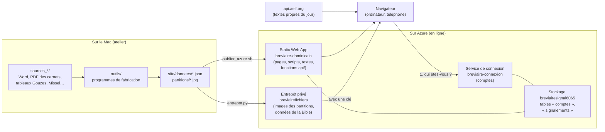
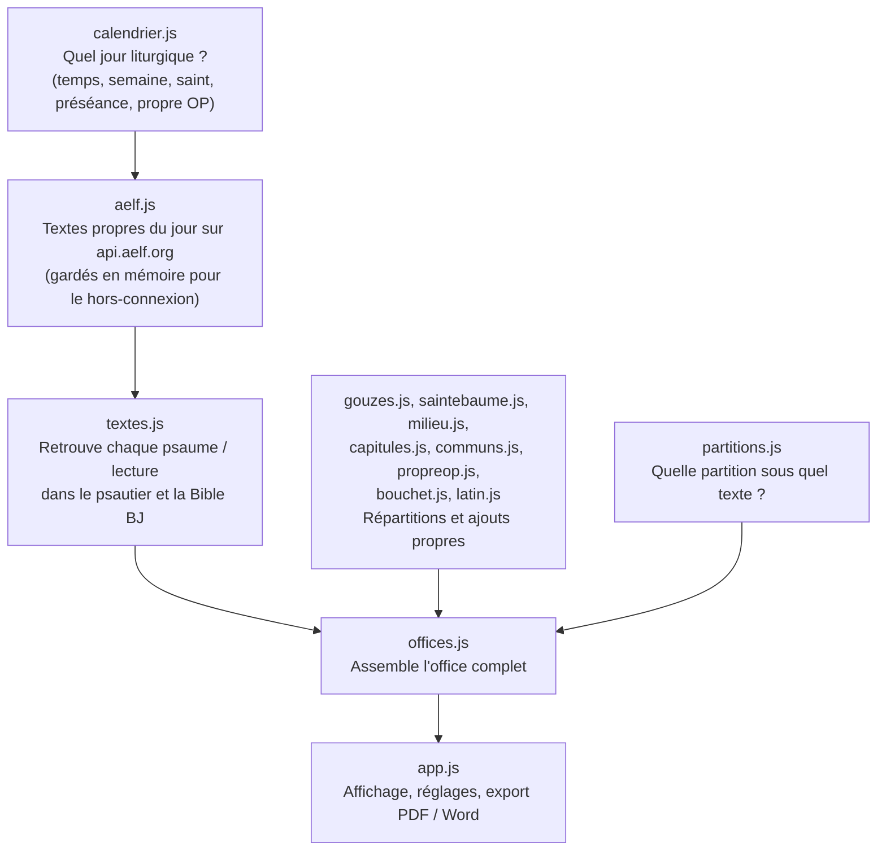

# Comment fonctionne le bréviaire — visite guidée

Ce document explique **comment la chose est construite**, des fichiers sur le Mac jusqu'au site en ligne sur
Azure, pour qu'on puisse le reprendre, le réparer ou le confier à quelqu'un d'autre. Il ne dit pas comment
*se servir* du site (voir `README.md` et `docs/MODE-D-EMPLOI-REGLAGES.md`).

Pour reprendre le projet, lire dans cet ordre : ce document ; `outils/LISEZMOI.md` (l'atelier)

---

## 1. L'idée en une image



Quatre idées à retenir :

1. **Tout le travail lourd est fait d'avance, sur le Mac.** Les programmes de `outils/` lisent les documents
   d'origine et en tirent des fichiers de données (`.json`) et des images de partitions. On ne les relance que
   quand une source change.
2. **Le site ne « calcule » rien sur un serveur.** C'est un *site statique* : un paquet de fichiers que le
   navigateur télécharge. C'est **le navigateur** qui assemble l'office du jour : il calcule la date liturgique,
   va chercher les textes propres sur le site de l'AELF, prend les psaumes dans le psautier BJ, et met les
   partitions au bon endroit.
3. **Azure héberge et garde la porte.** Il sert les fichiers, et ne laisse entrer que les personnes connectées
   (identifiant et mot de passe, vérifiés par le petit service de connexion). Quatre petites fonctions
   seulement tournent en ligne (dossier `api/`).
4. **Rien n'est propre à une année.** Le calendrier est perpétuel ; seules les sources (carnets, Missel…)
   changent, et alors on relance le programme correspondant.

---

## 2. Le dossier, pièce par pièce

| Dossier / fichier | À quoi il sert | Publié en ligne ? |
|---|---|---|
| `site/` | **Le site lui-même** : pages `.html`, `css/`, `js/`, `donnees/`, `polices/`, `sw.js` | oui (Static Web App) |
| `site/js/` | Les programmes qui tournent dans le navigateur (§ 3) | oui |
| `site/donnees/` | Psautier, Bible, calendrier, Gouzes, Missel, martyrologe… en `.json` (§ 4) | oui |
| `partitions/` | Images des partitions et leurs index | index : oui ; images : entrepôt privé |
| `bible/` | La Bible (vue téléphone et interlinéaire) et ses programmes de fabrication | pages : oui ; `bible/data/` : entrepôt privé |
| `api/` | Fonctions en ligne : `connexion` (service à part), `roles`, `fichiers` (clé de l'entrepôt), `signalements` | oui |
| `outils/` | Programmes de **fabrication** et de **publication** (voir `outils/LISEZMOI.md`) | non |
| `tests/` | Programmes de **contrôle** : `bash tests/tout.sh` | non |
| `sources_*/` | Les documents d'origine (`sources_bible`, `sources_gouzes`, `sources_missel`…) | non |
| `docs/` | Notices : réglages, sources et choix, partitions, mise en ligne, connexion, GitHub, sécurité | non |
| `archives/` | Ce qui ne sert plus (voir `archives/LISEZMOI.md`) | non |
| `Lancer le bréviaire.command` | Double-clic : ouvre le site sur le Mac (`outils/serveur.py`, port 8765) | non |
| `Mettre à jour les textes.command` | Double-clic : refait psautier, Bible, calendrier, Gouzes | non |

### Les pages du site

| Page | Rôle | Programme principal |
|---|---|---|
| `index.html` | Offices du jour, réglages, export PDF / Word, hors connexion, communs, calendrier OP | `js/app.js` → `js/offices.js` |
| `messe.html` | Messe du jour, Missel romain et Missel de l'Ordre à consulter, export | `js/messe.js` |
| `bibliotheque.html`, `table.html`, `prieres.html`, `martyrologe.html`, `defunts.html` | Bibliothèque et ses recueils | `js/bibliotheque.js`, `table.js`, `prieres.js`, `martyrologe.js`, `defunts.js` |
| `signalements.html` | Erreurs signalées (rôle « signalements ») | dans la page |
| `comptes.html` | Gestion des comptes — **publiée avec le service de connexion, pas avec le site** | dans la page |
| `bible/index.html`, `bible/interlineaire.html` | La Bible (téléphone, ordinateur) | `bible/lectio.js`, `bible/app.js` |

Toutes les pages chargent `js/menu.js` (barre Office · Messe · Bible · Bibliothèque, pied « Sources et droits »).

---

## 3. Ce qui se passe quand on ouvre l'office du jour

Le navigateur charge `site/index.html`, qui appelle les programmes de `site/js/` dans cet ordre de
responsabilité :



- **`calendrier.js`** — calcule Pâques et tout le temporal, lit le sanctoral (`sanctoral.json`) et le propre
  de l'Ordre (`propre_op.json`), applique la préséance et les transferts. Il marche pour n'importe quelle année.
- **`aelf.js`** — l'AELF ne publie qu'environ 9 mois à l'avance. Au-delà, le programme prend *le même jour
  liturgique* d'une année déjà publiée. Les réponses sont gardées dans le navigateur.
- **`textes.js`** — fait le lien entre une référence de l'AELF (« Ps 118-18 », « Cantique Ap 4-5 »…) et le
  psautier BJ, en gardant le gras des inflexions et la disposition des strophes.
- **`offices.js`** — le chef d'orchestre : il assemble chaque office selon la *version* choisie (100 % AELF,
  romaine, romain gouzantin, Sainte-Baume, gouzantine, latin-français).
- **`partitions.js`** — choisit les images (carnets de la Province, Sainte-Baume, Heures grégoriennes, pièces
  gravées LilyPond, complies de Bordeaux, milieu du jour de Marseille) et les place sous le texte, repliées.
- **`app.js`** — l'écran, les réglages, la fabrication des **PDF** (impression du navigateur) et des **Word**
  (`docx.js`, qui écrit le fichier `.docx` directement).
- **`sw.js` + `horsligne.js`** — permettent d'*enregistrer* une période (jusqu'à 100 jours) pour lire sans réseau.
- **`signaler.js`** — la bulle « Signaler » : l'erreur est gardée sur l'appareil puis envoyée à Azure.
- **`cle-fichiers.js`** — obtient, une fois connecté, la clé qui ouvre l'entrepôt des images.

---

## 4. L'atelier : comment les données sont fabriquées

Rien de cela ne tourne en ligne. On relance un programme **seulement si sa source change**. La liste complète,
avec l'ordre à respecter pour les partitions, est dans **`outils/LISEZMOI.md`**. En résumé :

| Fichier du site                                                    | Fabriqué par                                                                                         | À partir de                                                     |
| ------------------------------------------------------------------ | ---------------------------------------------------------------------------------------------------- | --------------------------------------------------------------- |
| `psautier.json`, `bible/`                                          | `construire_donnees.py`                                                                              | `sources_bible/*.doc`                                           |
| `sanctoral.json`                                                   | `construire_calendrier.py`                                                                           | relevé de l'AELF 2018-2027 + `corrections_sanctoral.json`       |
| `propre_op.json`, `missel_op.json`                                 | `construire_missel_op.py`                                                                            | Missel et Lectionnaire de l'Ordre (`sources_missel/op/`)        |
| `gouzes.json`, `sainte_baume.json`                                 | `construire_gouzes.py`, `construire_sainte_baume.py`                                                 | `sources_gouzes/`                                               |
| `milieu.json`, `complies.json`, `capitules.json`, `president.json` | `construire_milieu.py`, `construire_complies.py`, `capitules_province.py`, `construire_president.py` | carnets et documents de la Province                             |
| `offices_op.json`                                                  | `offices_op.py`                                                                                      | carnets du sanctoral (.docx)                                    |
| `bouchet.json`                                                     | `construire_bouchet.py`                                                                              | lectionnaire Bouchet                                            |
| `psautier_aelf.json`, `psautier_latin.json`                        | `construire_psautier_aelf.py`, `construire_psautier_latin.py`                                        | `sources_aelf/`, Bible latine                                   |
| `missel.json`                                                      | `construire_missel.py`                                                                               | `sources_missel/`                                               |
| `martyrologe.json`, `necrologe.json`, `table.json`, `prieres.json` | `construire_martyrologe.py`, `construire_table.py`, `construire_prieres.py`                          | `sources_martyrologe/`, `sources_table/`, `sources_compendium/` |
| `jours_saints.json`                                                | saisi à la main                                                                                      | livret de la communauté                                         |
| `partitions/…`                                                     | chaîne `rendre_partitions.sh` → `decouper_partitions.py` → … → `construire_ordo.py`                  | carnets de la Province (PDF, .docx)                             |
| `partitions/images-utilisees.json`                                 | `node outils/releve_images.mjs` (≈ 15 min)                                                           | le site lui-même, construit dans un navigateur                  |

Les corrections faites à la main sur les partitions vont dans `partitions/corrections.json` et
`partitions/corrections/` (voir `docs/CORRIGER-UNE-PARTITION.md`) : elles **ne sont jamais écrasées**.

**Contrôles** : `bash tests/tout.sh` lance les 20 contrôles de `tests/` (quelques secondes) : le calendrier ne
diffère jamais de celui de l'AELF sur 2018-2027, chaque référence trouve son texte, chaque partition citée
existe, etc. On les lance après toute modification.

---

## 5. Azure : ce qui est en ligne et où

Tout est dans l'abonnement « Azure subscription 1 », groupe de ressources **`breviaire`**, protégé par un verrou
contre la suppression (`protection-breviaire` : le retirer avant de supprimer quoi que ce soit) et suivi par un
budget d'alerte (30 €/mois, courriel au compte d'administration).

| Élément Azure | Nom | Rôle |
|---|---|---|
| **Static Web App** (Standard, Central US) | `breviaire-dominicain` | Le site : pages, scripts, textes (~20 Mo) et les fonctions `api/roles`, `api/fichiers`, `api/signalements`. Adresse : https://calm-flower-052e85c10.4.azurestaticapps.net |
| **Static Web App** (gratuite) | `breviaire-connexion` | Le service de connexion (`api/connexion`) et la page Comptes. Adresse : https://mango-bay-05d40a610.4.azurestaticapps.net. À part, car logé dans le site qu'il protège, Azure tournait en rond |
| **Compte de stockage « entrepôt »** (France Central) | `breviairefichiers`, conteneur `$web` | Images des partitions et données de la Bible (~450 Mo). **Privé** : lu avec une clé que `api/fichiers` donne aux seules personnes connectées |
| **Compte de stockage** (France Central) | `breviairesignal6065` | Tables `comptes` (frères et mots de passe chiffrés) et `signalements` |

Comment se passe une visite : Azure voit que la personne n'est pas connectée et l'envoie au service de
connexion ; celui-ci vérifie identifiant et mot de passe (table `comptes`) et répond à Azure « c'est fr. X,
rôles … » ; Azure laisse alors passer, pour un an sur cet appareil. Détails, rôles et limites : `docs/CONNEXION.md`.

Réglages importants :
- `site/staticwebapp.config.json` : en-têtes (pas d'indexation par les moteurs de recherche, durées de garde) ;
  à la publication, `outils/connexion_azure.json` y ajoute les règles d'accès.
- Variables des deux Static Web Apps (posées par `outils/preparer_connexion.sh`, jamais dans git) : accès aux
  tables, clés de signature de la connexion, clé de l'entrepôt.
- L'entrepôt n'accepte les demandes que venant du site en ligne et du Mac (`localhost:8765`).
- L'ancien mot de passe commun d'Azure est désactivé et doit le rester.

### Publier une nouvelle version

```bash
bash tests/tout.sh
```
```bash
node outils/releve_images.mjs
```
```bash
bash outils/publier_azure.sh --essai
```
prépare tout et affiche la taille, **sans rien envoyer**. Puis, pour de vrai :

```bash
bash outils/publier_azure.sh
```

Le programme vérifie que la liste des images est à jour, copie `site/` (et la Bible) dans un dossier
temporaire, envoie les images et la Bible dans l'entrepôt (seulement ce qui a changé), puis le reste dans la
Static Web App, avec la connexion obligatoire. Il faut avoir fait une fois `az login` sur le Mac. Le service de
connexion se publie à part : `bash outils/publier_connexion.sh`. Détails : `docs/MISE-EN-LIGNE-AZURE.md`.

---

## 6. Et GitHub, à quoi ça sert ?

**GitHub est un coffre-fort à versions**, en ligne. On y dépose des « photographies » successives du dossier
(*commits*), chacune avec une phrase qui dit ce qui a changé. Cela sert à :

- **sauvegarder** : si le Mac est perdu, tout le travail est récupérable ;
- **revenir en arrière** : retrouver le dossier tel qu'il était tel jour, ou voir ce qu'une modification a changé ;
- **transmettre** : un frère, ou un informaticien, peut récupérer le projet complet d'un coup.

GitHub **n'est pas** le site : le site est sur Azure. Le dépôt (`frwandrille/psautier`) est **privé** et doit le
rester, car il contient les textes de la Bible de Jérusalem, les polices Kepler (licence Adobe) et les partitions
des carnets. Marche à suivre : `docs/TRAVAILLER-AVEC-GITHUB.md`.

Ce qui n'est **jamais** envoyé sur GitHub (fichier `.gitignore`) : les clés et secrets (`.cle_*.txt`,
`.secrets_connexion/`), les signalements, les données reconstruites de la Bible (`bible/data/`), les archives
temporaires d'Azure, la sauvegarde `archives/*.tar.gz`, les comptes rendus des contrôles.

---

## 7. Si quelque chose casse

1. `bash tests/tout.sh` : les contrôles disent souvent où.
2. Regarder les signalements : page `signalements.html` du site (rôle « signalements »), ou
   `python3 outils/signalements.py --azure`.
3. Revenir à la dernière version enregistrée sur GitHub si une modification a tout cassé.
4. Si personne ne peut plus se connecter : voir `docs/CONNEXION.md` (clé d'administration de secours
   `.cle_comptes.txt`, republier le service avec `outils/publier_connexion.sh`).
